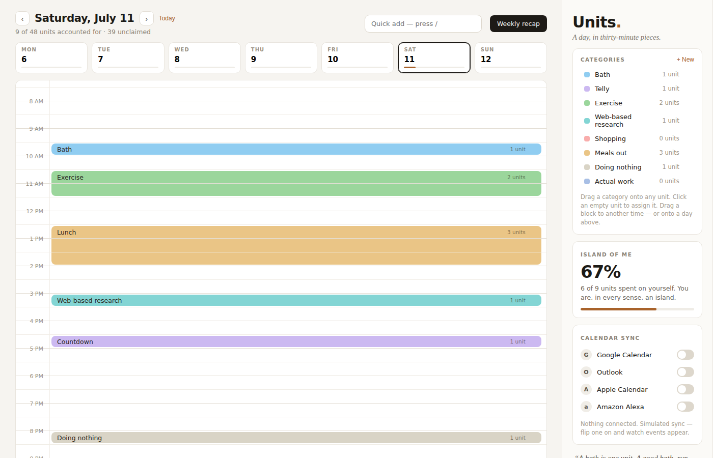

# UnitsOfTime

Track your activities as units of time, inspired by Will Freeman from *About A Boy*: a day is 48 half-hour units, dragged and dropped into place.

> "I find the key is to think of a day as units of time, each unit consisting of no more than thirty minutes. Full hours can be a little bit intimidating and most activities take about half an hour."



## Features

- Single-day grid (48 half-hour units) with drag-and-drop assignment and rearranging
- Color-coded, user-defined categories
- Quick-add palette (press `/`, type a category name, hit Enter)
- "Island of me" — how many units today went to yourself vs. everything else
- Weekly recap modal with per-category totals
- Calendar sync panel (Google/Outlook/Apple/Amazon) — currently **simulated**: toggling a provider on fills in fixed demo events so the UI/UX can be evaluated before real OAuth integration is built. See `src/units/calendar/` for the swappable `CalendarProvider` interface.
- Responsive layout (sidebar moves below the grid on narrow viewports)

State persists to `localStorage` — there's no backend yet.

## Getting started

Requires Node 20+.

```bash
git clone https://github.com/RetiredOnMyTerms/UnitsOfTime.git
cd UnitsOfTime
npm install
npm run dev
```

Then open the URL Vite prints (typically http://localhost:5173).

Other scripts:

```bash
npm run build     # type-check + production build
npm run lint       # oxlint
```

## Project layout

- `src/units/useUnitsApp.ts` — all app state and mutations (entries, categories, sync, drag state, quick add, etc.)
- `src/units/logic.ts` — pure view-model helpers (grid cells, slot rendering, recap/island-of-me calculations)
- `src/units/calendar/` — calendar sync abstraction; `simulatedProvider.ts` is the only implementation today
- `src/units/components/` — presentational components

## Roadmap

- Real calendar sync (OAuth against Google/Outlook/Apple; Amazon Alexa has no real calendar API to integrate with)
- Persisting to something other than `localStorage`

## Contributing

Contributions are welcome — see [CONTRIBUTING.md](CONTRIBUTING.md) for local setup, the pre-PR checklist, and code style notes. `main` requires a reviewed pull request; direct pushes aren't accepted.

## Security

See [SECURITY.md](SECURITY.md) for how to report a vulnerability privately.

## License

[GPL-3.0](LICENSE).
